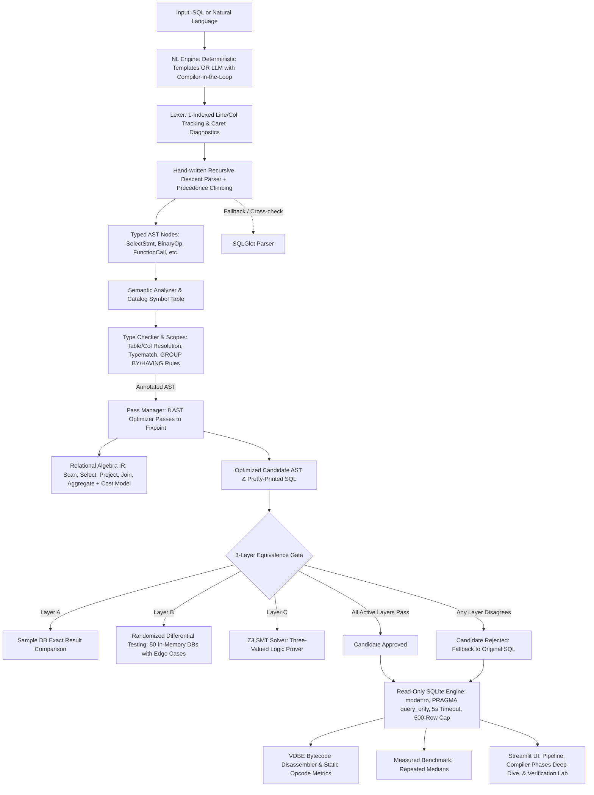

# Intelligent SQL Query Compiler

An educational compiler-design SQL optimization, verification, and execution system built for a college Compiler Design project. It demonstrates classical compiler phases (lexing, recursive-descent parsing with precedence climbing, symbol table analysis, type checking, multi-pass AST rewrites, relational algebra IR lowering, and bytecode inspection) paired with modern compiler-in-the-loop AI guardrails and formal SMT equivalence verification.

---

## 1. Architecture



---

## 2. Feature Matrix: Implemented vs. Optional

| Classical Phase | Feature | Status | Notes |
| :--- | :--- | :--- | :--- |
| **Frontend** | Regex Lexer with line & column tracking | **Implemented** | 1-indexed, caret-pointing `LexicalError`. |
| **Frontend** | Recursive Descent + Precedence Climbing Parser | **Implemented** | Full AST classes in `ast_nodes.py`. Handles joins, aggregates, GROUP BY, HAVING, ORDER BY, LIMIT (subqueries are not supported by hand-written parser; queries with subqueries fall back to SQLGlot). |
| **Frontend** | AST Pretty-printer (`ast_to_sql`) & Graphviz DOT | **Implemented** | Complete round-trip equivalence tested. |
| **Semantic** | SQLite Catalog Symbol Table (`symbols.py`) | **Implemented** | Introspects `PRAGMA table_info`, tracks column data types, nullability, and query-level scopes/aliases. |
| **Semantic** | Semantic Diagnostics & Type Checker (`typecheck.py`) | **Implemented** | E101-E501 codes with caret messages and `difflib` "Did you mean?" suggestions. Enforces standard aggregation & grouping rules. |
| **Optimizer** | Multi-Pass AST Rewriter & Trace (`manager.py`) | **Implemented** | 8 passes applied iteratively to fixpoint: constant folding, boolean simplification, range consolidation, contradiction detection, DISTINCT removal, `*` expansion, predicate pushdown, and IN normalization. |
| **Intermediate Rep.** | Relational Algebra IR & Cost Model (`algebra.py`) | **Implemented** | Lowers AST to $\sigma$, $\pi$, $\bowtie$, $\gamma$, etc. Estimates selectivity/cardinality; suggests optimal left-deep join order. |
| **Verification** | Layer A: Sample DB execution comparison | **Implemented** | Multiset and ordered row comparisons on sample database. |
| **Verification** | Layer B: Randomized Differential Testing (`difftest.py`) | **Implemented** | In-memory SQLite generation with NULLs, duplicates, empty tables, and boundary values across 50 tests. |
| **Verification** | Layer C: Z3 SMT Formal Equivalence Prover (`smt.py`) | **Optional** | Translates predicates to Z3 under SQL 3-valued logic. Formally proves equivalence (UNSAT) or produces counterexamples (SAT). Requires `z3-solver`. |
| **Verification** | Mutation Testing Demo (`mutation.py`) | **Implemented** | 5 deliberate optimizer bugs caught and classified by the verification gate. |
| **Codegen** | VDBE Bytecode Disassembler (`bytecode.py`) | **Implemented** | Runs SQLite `EXPLAIN`, extracts opcodes, and counts static loop/seek/sorter complexities. |
| **Natural Language**| Deterministic Schema-Aware Template Generator | **Implemented** | Recognizes synonyms ("pupils", "marks"), department/age filters, and 3-table joins. |
| **Natural Language**| Compiler-in-the-Loop LLM Generator (`llm.py`) | **Optional / Disabled** | Connects to OpenAI, Ollama, or custom endpoints. Untrusted output is verified by parser and semantic checker with 2-attempt diagnostic repair loop. |
| **Execution** | Read-Only Safe Execution Engine | **Implemented** | URI `mode=ro`, `PRAGMA query_only = ON`, SQLite progress-handler timeout (5s), and 500-row cap. |
| **UI** | Streamlit Interactive Explorer (`app.py`) | **Implemented** | "Compiler Phases" inspection tab, AST/Algebra Graphviz visualizations, verification mutant test lab, and benchmark report generator. |

---

## 3. Installation & Setup

Python 3.10 or newer is recommended. Run commands from the repository root:

### macOS / Linux
```bash
python3 -m venv .venv
source .venv/bin/activate
python -m pip install -r requirements.txt -r requirements-dev.txt
python person2/database.py
streamlit run app.py
```

### Windows (PowerShell)
```powershell
py -m venv .venv
.\.venv\Scripts\Activate.ps1
python -m pip install -r requirements.txt -r requirements-dev.txt
python person2/database.py
streamlit run app.py
```

*Note: Initializing the database creates `person2/university.db` from `person2/schema.sql` seeded with 1,000 students, 10 courses, and 3,000 enrollments.*

---

## 4. Enabling Optional Components

### A. Z3 SMT Theorem Prover (Layer C Verification)
Z3 enables formal mathematical proof of predicate equivalence under SQL three-valued logic.
```bash
pip install z3-solver
```
If `z3-solver` is not installed, the verification gate continues safely using Layers A and B, reporting `Layer C: z3-solver unavailable`.

### B. Generative AI / LLM Integration (Compiler-in-the-Loop)
By default, generative AI is disabled and the app uses the deterministic template generator. To enable LLM generation, set environment variables or create a `.streamlit/secrets.toml` file:

```bash
# Example 1: Local Ollama (OpenAI-compatible)
export LLM_PROVIDER="ollama"
export LLM_BASE_URL="http://localhost:11434/v1"
export LLM_MODEL="llama3"

# Example 2: OpenAI API
export LLM_PROVIDER="openai"
export LLM_API_KEY="sk-..."
export LLM_MODEL="gpt-4o-mini"
```

When active, untrusted LLM outputs are sent through the compiler's lexer, parser, and semantic analyzer. Any syntax or type errors trigger an automated diagnostic feedback loop (up to 2 repair attempts). If repair fails, the system automatically falls back to the deterministic template generator.

---

## 5. Running Tests & Evaluation

The full test suite is completely automated and green:
```bash
python -m pytest -q
# Expected: 153 passed in ~1.2s
```

### Generating the Large Benchmark Database
To evaluate query execution on a realistically sized database (200,000 students and ~600,000 enrollments):
```bash
python scripts/make_large_db.py --students 200000 --output person2/large_university.db
```
*(This generates a separate database file without overwriting the standard `university.db`.)*

### Evaluating Natural Language Phrasing (Author Regression Test)
Run the author-written regression test suite of 32 English queries against gold SQL benchmarks (this is an author-written test suite verifying supported templates and phrasing, NOT an independent third-party accuracy benchmark):
```bash
python scripts/eval_nl.py
```

---

## 6. What This Project Does NOT Claim

In accordance with strict academic compiler engineering standards:
1. **No universal equivalence without proof:** Finite result comparison on a sample database (Layer A) or 50 random databases (Layer B) provides empirical evidence, not formal proof. The term **"proved equivalent"** is strictly reserved for Layer C when Z3 returns `UNSAT`.
2. **Timing differences on small DBs are noisy:** SQLite timings on a 1,000-row database fluctuate with OS scheduling and CPU cache state. Static VDBE opcode complexity counts are provided as deterministic proxies.
3. **No automatic index creation:** The optimizer analyzes query structure and suggests optimal relational join ordering; it never mutates the underlying SQLite database schema or adds indexes.
4. **Join order suggestions are informational:** The cost-based dynamic programming join optimizer calculates estimated relative costs based on database statistics, but does not force SQLite's query planner via `CROSS JOIN` unless explicitly requested.
5. **Generative AI is not trusted blindly:** LLMs frequently hallucinate column names or invalid syntax. In this system, LLM responses are treated as untrusted user source code that must pass lexical, syntactic, semantic, and equivalence gate validation.
6. **No subqueries in hand-written parser:** The hand-written parser supports SELECT queries with joins, arithmetic/boolean expressions, GROUP BY, HAVING, ORDER BY, and LIMIT. Nested subqueries (such as `WHERE x IN (SELECT ...)` or `(SELECT 1) = 1`) produce clean parse diagnostics and fall back to SQLGlot without crashing.

---

## 7. Viva & Demonstration Walkthrough

1. **Front-End & Grammar:** Open **Query Studio**, enter a complex multi-table join or nested boolean query (`gpa >= 8.5 AND (age < 22 OR credits > 60)`). Navigate to the **Compiler Phases** tab to inspect the Token Stream, the Concrete Parse Tree, and the Graphviz diagram.
2. **Semantic Type Checking & Suggestions:** Enter `SELECT salary FROM students;` or `SELECT gpa + department FROM students;`. View the structured `E201`/`E301` compiler diagnostic with exact line/column indicators and `difflib` "Did you mean?" suggestions.
3. **Multi-Pass Optimizer Trace:** Select the **Redundant Range Filter** or **Constant Folding** example. Expand **Phase 4: Optimizer Trace** to view each pass firing sequentially with before/after SQL diffs until fixpoint.
4. **Relational Algebra IR & Cost Model:** View the lower-level operator tree ($\pi$, $\sigma$, $\bowtie$) and inspect the cost model's table cardinality estimates and join-order optimization recommendations.
5. **3-Layer Verification Gate:** Switch to the **Verification Lab** tab. Test a valid query against all 3 layers (Sample DB, 50 Random DBs, Z3 SMT prover). Then run the **Buggy Optimizer Mutation Demo** to watch the gate catch 5 deliberate optimizer bugs with counterexamples.
6. **Bytecode Inspection:** Open **Phase 7: Code Generation View** to compare SQLite VDBE virtual machine opcodes (loops, index seeks, sorter allocations) between original and optimized queries.
7. **Compiler-in-the-Loop AI:** Switch input mode to **Natural Language**. Try phrasing with synonyms ("Show pupils with marks above 9.0"). The system explains whether template matching or LLM inference was used and displays the validation status.
8. **Benchmark & Report:** Click **Benchmark Queries** to generate a Markdown report with plan analysis, deterministic opcode metrics, and execution timing medians.
