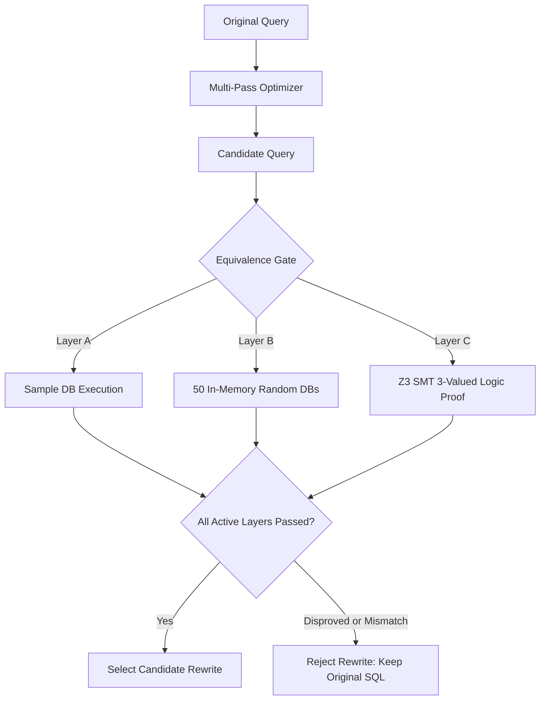

# SQL Compiler Upgrade Notes & Architectural Mapping

This document provides a comprehensive technical overview of the upgraded Intelligent SQL Compiler, mapping classical compiler phases to codebase modules, outlining optimizer safety criteria, explaining the three-layer equivalence gate, and providing viva-ready talking points.

---

## 1. Classical Compiler Phase Mapping Table

| Compiler Phase | Implementation Module / File | Description & Capabilities |
| :--- | :--- | :--- |
| **Source & Lexical Analysis** | `sqlcompiler/frontend/lexer.py` | Regex tokenizer with 1-indexed line and column tracking, SQL keywords, operators, comments, string/number literals, and caret-style lexical error reporting. |
| **Syntactic Analysis** | `sqlcompiler/frontend/parser.py` `sqlcompiler/frontend/ast_nodes.py` | Recursive descent + precedence climbing parser implementing the formal EBNF grammar in `docs/GRAMMAR.md`. AST nodes for `SelectStmt`, `SelectItem`, `TableRef`, `Join`, expressions, functions, and pretty-printer `ast_to_sql()`. |
| **Semantic Analysis & Type Checking** | `sqlcompiler/semantic/symbols.py` `sqlcompiler/semantic/typecheck.py` `sqlcompiler/semantic/diagnostics.py` | SQLite catalog symbol table (`PRAGMA table_info`), alias/scope manager, type checker with fuzzy "Did you mean?" suggestions, GROUP BY / HAVING validation, aggregate misuse detection, and AST type annotation. |
| **Intermediate Representation (IR)** | `sqlcompiler/ir/algebra.py` | Relational algebra IR (`Scan`, `Select`, `Project`, `JoinNode`, `AggregateNode`, `SortNode`, `LimitNode`, `DistinctNode`), cost model based on table cardinality and predicate selectivity, Graphviz DOT export, and join-order optimization proposal. |
| **Target-Independent Optimization** | `sqlcompiler/optimizer/passes.py` `sqlcompiler/optimizer/manager.py` | Multi-pass iterative AST optimizer running to fixpoint (max 10 iterations) with step-by-step rewrite trace, constant folding, boolean simplification, range consolidation, contradiction detection, distinct removal, and predicate pushdown. |
| **Equivalence Verification Gate** | `sqlcompiler/verify/difftest.py` `sqlcompiler/verify/smt.py` `sqlcompiler/verify/mutation.py` | Three-layer verification gate before candidate selection: Layer A (sample DB comparison), Layer B (50 in-memory random DBs differential testing), Layer C (Z3 SMT solver formal equivalence proof under SQL 3-valued logic). Includes mutation testing suite. |
| **Code Generation & Virtual Machine View** | `sqlcompiler/codegen/bytecode.py` | SQLite VDBE virtual machine bytecode inspection (`EXPLAIN`), opcode categorization (loops, index seeks, sorter, scans, flow control), and deterministic static complexity metrics comparing original vs. candidate queries. |
| **Target Execution & Benchmark** | `person2/execution_engine.py` `person2/evaluation.py` | Sandboxed read-only SQLite execution (`mode=ro`, `PRAGMA query_only = ON`, 5-second progress-handler interrupt, 500-row cap), query plan inspection (`EXPLAIN QUERY PLAN`), and multi-run latency benchmarking. |
| **Natural Language Front End** | `sqlcompiler/nl/nl_to_sql.py` `sqlcompiler/nl/llm.py` | Enhanced deterministic template generator with schema lexicon & synonyms; optional compiler-in-the-loop LLM generator with automatic 2-attempt diagnostic repair loop and template fallback. |
| **User Interface** | `app.py` `pipeline.py` | Streamlit interactive workbench featuring Query Studio, Compiler Phases deep dive (Graphviz AST & IR, token inspection, semantic diagnostics, bytecode diffs), Verification Mutant Demo, and Optimization Lab. |

---

## 2. Inventory of New and Modified Files

### New Package Layout (`sqlcompiler/`)
- `sqlcompiler/__init__.py`: Package root initialization.
- `sqlcompiler/frontend/lexer.py`: Hand-written lexer with line/col tracking and caret snippet errors.
- `sqlcompiler/frontend/ast_nodes.py`: Real AST dataclasses, pretty-printer, dict/tree serialization, and Graphviz DOT generator.
- `sqlcompiler/frontend/parser.py`: Recursive descent + precedence climbing parser with structured `ParseError` diagnostics.
- `sqlcompiler/frontend/__init__.py`: Frontend exports.
- `sqlcompiler/semantic/diagnostics.py`: Structured `Diagnostic` class with severity, error codes (E101–E501), hints, and formatting.
- `sqlcompiler/semantic/symbols.py`: SQLite `Catalog` metadata extractor, `TableSymbol`, `ColumnSymbol`, and query `Scope`.
- `sqlcompiler/semantic/typecheck.py`: Semantic validator and type checker enforcing SQL constraints.
- `sqlcompiler/semantic/__init__.py`: Semantic exports.
- `sqlcompiler/optimizer/passes.py`: 8 modular optimization passes with conservative safety checks.
- `sqlcompiler/optimizer/manager.py`: `PassManager` running passes to fixpoint with trace logging.
- `sqlcompiler/optimizer/__init__.py`: Optimizer exports.
- `sqlcompiler/ir/algebra.py`: Relational algebra IR, text/DOT renderer, cost model, and join order heuristics.
- `sqlcompiler/ir/__init__.py`: IR exports.
- `sqlcompiler/verify/difftest.py`: Layer B randomized differential tester across in-memory SQLite instances.
- `sqlcompiler/verify/smt.py`: Layer C formal SMT predicate equivalence prover using Z3.
- `sqlcompiler/verify/mutation.py`: Mutation testing suite with 5 faulty rewrite rules evaluated against the gate.
- `sqlcompiler/verify/__init__.py`: Verification exports.
- `sqlcompiler/codegen/bytecode.py`: SQLite VDBE bytecode disassembler, categorization, and metric comparator.
- `sqlcompiler/codegen/__init__.py`: Codegen exports.
- `sqlcompiler/nl/nl_to_sql.py`: Enhanced deterministic template generator with synonyms and 3-table join support.
- `sqlcompiler/nl/llm.py`: Compiler-in-the-loop LLM generator with diagnostic feedback repair loop.
- `sqlcompiler/nl/__init__.py`: NL exports.
- `sqlcompiler/engine/__init__.py`: Engine re-exports and integration.

### Documentation and Scripts
- `docs/GRAMMAR.md`: Formal EBNF grammar specification with precedence table and left recursion elimination notes.
- `docs/UPGRADE_NOTES.md`: This comprehensive compiler design and viva document.
- `scripts/make_large_db.py`: Synthetic generator for a realistic benchmark database (default 200,000 students).
- `scripts/eval_nl.py`: Natural language evaluation script with 32 questions and gold SQL.

### Test Suite (`tests/`)
- `tests/__init__.py`: Test suite package init.
- `tests/test_frontend.py`: 75 unit tests for lexer, parser, operator precedence, errors, roundtrip, and SQLGlot cross-checks.
- `tests/test_semantic.py`: 15 unit tests covering each semantic validation rule and "Did you mean?" suggestions.
- `tests/test_optimizer_passes.py`: 21 unit tests verifying each pass fires correctly and does NOT fire when unsafe.
- `tests/test_algebra.py`: 5 tests for algebra lowering, cost model sanity, and join order selection.
- `tests/test_verify.py`: 5 tests for differential testing, Z3 SMT proofs (UNSAT/SAT), and mutation detection.
- `tests/test_bytecode.py`: 2 tests for VDBE bytecode disassembly and metric comparison.
- `tests/test_llm.py`: 5 tests for mock LLM repair loop, security constraints, and template fallback.

### Updated Existing Files
- `person 1/lexer.py`: Re-exports from `sqlcompiler.frontend.lexer`.
- `person 1/parser.py`: Re-exports from `sqlcompiler.frontend.parser`.
- `person 1/optimizer.py`: Re-exports from `sqlcompiler.optimizer.manager`.
- `person 1/nl_to_sql.py`: Re-exports from `sqlcompiler.nl.nl_to_sql`.
- `person 1/compiler.py`: Updated to use the new compiler frontend and AST.
- `person2/__init__.py`: Added sys.path handling so `person2` modules can be imported cleanly from anywhere.
- `pipeline.py`: Upgraded to integrate all compiler phases, the 3-layer equivalence gate, and bytecode metrics.
- `app.py`: Streamlit UI upgraded with the "Compiler Phases" view, verification mutant demo, and example gallery.
- `requirements.txt`: Added optional `z3-solver`.
- `requirements-dev.txt`: Clean development requirements.
- `.gitignore`: Enhanced to cover `.venv`, `__pycache__`, `.pytest_cache`, `.DS_Store`, `__MACOSX`, and `*.db`.
- `sample-benchmark-report.md`: Regenerated from a real run on the sample database.

---

## 3. Optimizer Passes and Safety Conditions

| Pass Name | Transformation Pattern | Safety Conditions & Invariants |
| :--- | :--- | :--- |
| **Constant Folding** | `2 + 3 -> 5` `1 = 1 -> TRUE` | Operates only on compile-time literal values. Never divides by zero (`x / 0` remains untouched). Respects SQL `NULL` three-valued logic (`NULL = 5` evaluates to `NULL`, not `FALSE`). |
| **Boolean Simplification** | `x AND TRUE -> x` `x OR FALSE -> x` `NOT NOT x -> x` `x AND x -> x` | Preserves three-valued logic (`NULL AND FALSE` is `FALSE`, while `NULL AND TRUE` remains `NULL`). Idempotent duplicate removal checks AST equality. |
| **Range Predicate Consolidation** | `gpa >= 9.0 AND gpa >= 8.0 -> gpa >= 9.0` `gpa > 8.0 AND gpa >= 8.0 -> gpa > 8.0` | Only consolidates comparisons on identical column references and numeric constants. Correctly models strictness (`>` is strictly tighter than `>=` for identical numeric bounds). Preserves non-numeric columns. |
| **Contradiction Detection** | `gpa > 9.0 AND gpa < 5.0 -> 1 = 0` | Only triggers when bounds on the same column are provably disjoint (e.g. lower bound > upper bound for numbers). Never fires on overlapping or satisfiable intervals (e.g. `gpa > 5.0 AND gpa < 9.0`). |
| **Redundant DISTINCT Removal** | `SELECT DISTINCT student_id, name FROM students -> SELECT student_id, name ...` | Only fires on single-table queries where the projected select items include the table's primary key (guaranteeing uniqueness at the schema level). Never removes DISTINCT from joins or queries lacking the primary key. |
| **SELECT * Expansion** | `SELECT * FROM courses -> SELECT course_id, title, ...` | Expands wildcards against the database catalog metadata. Provides subsequent compiler passes with explicit column visibility. |
| **Predicate Pushdown** | `SELECT ... FROM students s JOIN enrollments e ON ... WHERE e.grade = 'A'` | Pushes single-table filter predicates into the corresponding `JOIN ... ON` condition. **CRITICAL INVARIANT:** Only permitted for pure `INNER JOIN` queries. Strictly disallowed from pushing predicates through the null-extended side of a `LEFT JOIN`. |
| **IN / BETWEEN Normalization** | `col IN (42) -> col = 42` | Normalizes single-element IN lists into direct equality comparisons to expose them to indexing and range merging passes. |

---

## 4. The Three-Layer Verification Gate and Its Theoretical Limits

A query optimization rewrite is only selected if every active layer confirms equivalence:

### Layer A: Finite Sample Database Comparison
- **Mechanism:** Executes both queries on the active university SQLite database (up to 500 rows). Compares result sets as multisets (or exact ordered sequences if `ORDER BY` is present).
- **Scope & Limitations:** Finite checking on a single database state is an empirical sanity check. It catches gross errors on known data but **cannot prove equivalence** for future or unobserved data states.

### Layer B: Randomized Differential Testing
- **Mechanism:** Dynamically spins up 50 independent in-memory SQLite instances (`:memory:`) populated with synthesized edge-case rows: boundary GPA values (0.0, 10.0, exact query constants), extreme ages (16, 100), NULLs in nullable columns, duplicate rows, empty tables, and single-row tables.
- **Scope & Limitations:** Fuzzing provides high statistical confidence across arbitrary schema-valid database instances. However, because the space of all possible database states is infinite, random testing remains **evidence, not a formal mathematical proof**.

### Layer C: Formal SMT Proof with Z3 Solver
- **Mechanism:** Translates single-table SQL filter predicates into first-order logic formulas in Z3. Accurately models SQL three-valued logic by encoding each column as `(value: Real, is_null: Bool)` and each predicate as `(is_true: Bool, is_null: Bool)`. Injects table CHECK constraints (`gpa BETWEEN 0.0 AND 10.0`, `age BETWEEN 16 AND 100`). Asserts:
  $$\exists \text{ row }: \text{is\_true}(\text{original}) \neq \text{is\_true}(\text{candidate})$$
- **Theoretical Guarantee:**
  - **UNSAT:** Formally **proves** that under the declared schema constraints, no row can ever produce a different filtering decision. Only here is the term **"proved"** used.
  - **SAT:** Yields a concrete mathematical counterexample row demonstrating non-equivalence.
- **Scope & Limitations:** Limited to first-order predicate logic over numeric and string comparisons, boolean connectives, and NULL checks on single-table queries. Multi-table joins and arbitrary user-defined functions fall back to Layers A and B.

---

## 5. Viva-Ready Contribution Paragraph & Honest Limitations

> **"This project implements an end-to-end SQL compiler and verification system that replaces heuristic optimization with formal compiler engineering. We developed a complete hand-written front end—comprising a regex lexer with source coordinate tracking, an EBNF-driven recursive descent parser with precedence climbing, and an AST pretty-printer—paired with a schema-aware semantic analyzer that provides fuzzy diagnostic suggestions and type inference. Our multi-pass AST optimizer executes conservative rewrite passes (including constant folding, redundant range consolidation, and predicate pushdown) with full trace auditing. To prevent optimization bugs, we introduced a three-layer verification gate combining sample database execution, randomized in-memory differential testing across 50 edge-case databases, and formal mathematical proof via the Z3 SMT solver under SQL three-valued logic. Finally, we provide a compiler-in-the-loop generative AI guardrail where untrusted LLM queries are validated and repaired before execution, alongside VDBE bytecode static complexity metrics.
>
> **Honest Limitations:** While Z3 provides formal mathematical proofs for single-table predicate rewrites, general multi-table joins with aggregations rely on differential testing rather than full relational calculus proofs. Execution timings on the 1,000-row sample database are subject to operating system scheduling noise and should not be cited as general speedups; VDBE opcode count is our primary deterministic complexity metric. Natural language accuracy figures reflect an author-written regression test suite for covered phrasings, not an independent benchmark. All cloud AI capabilities are strictly optional, and the system functions completely offline using deterministic templates."**
